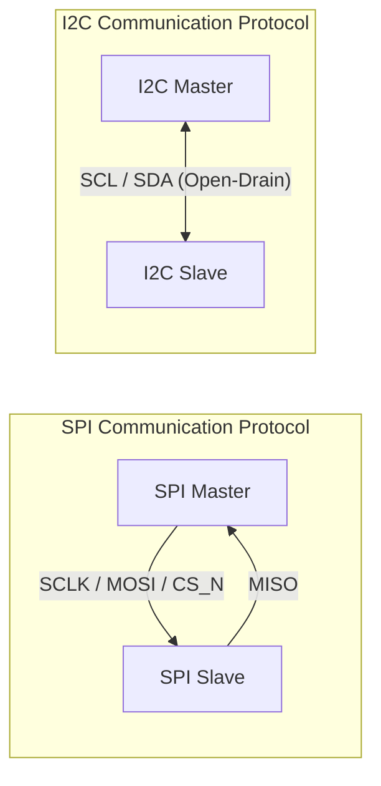

# 📡 FPGA Serial Communication Protocol IP (SPI & I2C)


본 프로젝트는 FPGA 기반 온칩/오프칩 시스템 구현을 위한 **SPI (Serial Peripheral Interface)** 및 **I2C (Inter-Integrated Circuit)** 직렬 통신 프로토콜 IP 코어 종합 라이브러리입니다.

---

## 💡 Supported Communication Protocols

### ⚡ 1. SPI (Serial Peripheral Interface) Protocol
- **RTL Modules**: `spi_master.sv`, `spi_slave.sv`, `spi_top.sv`, `master_top.sv`, `demo_top.sv`
- **Features**: Full-Duplex, Mode 0~3 (CPOL/CPHA) 파라미터 제어, SCLK/MOSI/MISO/CS_N 인터페이스 구축

### 🚌 2. I2C (Inter-Integrated Circuit) Protocol
- **RTL Modules**: `i2c_master.sv`, `i2c_slave.sv`, `i2c_demo_top.sv`
- **Features**: Open-Drain SDA/SCL 양방향 버스 제어, 7-bit Address Matching, ACK/NACK 응답 처리

---

## 📊 System Architecture & Protocol Diagram



---

## 📂 Directory Structure

```text
📦 Communication
 ┣ 📂 rtl
 ┃ ┣ 📂 spi/            # SPI Master/Slave & Top RTL Source Files
 ┃ ┗ 📂 i2c/            # I2C Master/Slave & Top RTL Source Files
 ┣ 📂 tb
 ┃ ┣ 📂 spi/            # SPI Testbench Simulation Files
 ┃ ┗ 📂 i2c/            # I2C Testbench Simulation Files
 ┣ 📂 docs/             # Protocol Timing Diagrams & Documentation
 ┗ 📜 .gitignore        # EDA Garbage File Filter
```

---

## 🛠️ Simulation & Verification Guide

### 1. SPI Simulation (AMD Vivado XSIM)
```bash
xvlog -sv rtl/spi/*.sv tb/spi/*.sv
xelab tb_spi_master -s tb_spi_sim -debug typical
xsim tb_spi_sim -gui

# 1. VCS Compile & Elaboration (KDB/Coverage/FSDB 옵션 적용)
vcs -sverilog -kdb -debug_access+all \
    -cm line+cond+fsm+tgl+branch \
    -f filelist_spi.f \
    -top tb_spi_master \
    -o simv_spi

# 2. Simulation Execution & Coverage/FSDB Extraction
./simv_spi -cm line+cond+fsm+tgl+branch -cm_name spi_test_cov

# 3. Verdi GUI Debugging & Coverage Viewing
verdi -ssf nova.fsdb &
urg -dir simv_spi.vdb -report urgReport_spi   # 커버리지 리포트 생성

```

### 2. I2C Simulation (AMD Vivado XSIM)
```bash
xvlog -sv rtl/i2c/*.sv tb/i2c/*.sv
xelab tb_i2c_master -s tb_i2c_sim -debug typical
xsim tb_i2c_sim -gui

# 1. VCS Compile & Elaboration
vcs -sverilog -kdb -debug_access+all \
    -cm line+cond+fsm+tgl+branch \
    -f filelist_i2c.f \
    -top tb_i2c_master \
    -o simv_i2c

# 2. Simulation Execution
./simv_i2c -cm line+cond+fsm+tgl+branch -cm_name i2c_test_cov

# 3. Verdi GUI Debugging
verdi -ssf nova.fsdb &
urg -dir simv_i2c.vdb -report urgReport_i2c
```

---

## 👨‍💻 Author

- **GitHub**: [@ethan000106](https://github.com/ethan000106)
