# 🔌 SPI & I2C Communication IP — RTL Design & UVM Verification

[-purple.svg)]()
[-orange.svg)]()

> **동기식 직렬 통신 프로토콜인 SPI와 I2C의 Master / Slave를 RTL로 설계하고, FND 출력으로 확인하는 Top에서 UVM 환경으로 검증한 미니 프로젝트**
> Basys 3 보드 1대(Loopback)와 2대(Master ↔ Slave 분리)로 실제 동작을 확인했습니다.

---

## 📋 Table of Contents
1. [Overview](#-overview)
2. [SPI](#-spi)
3. [I2C](#-i2c)
4. [UVM Verification](#-uvm-verification)
5. [Implementation](#-implementation)
6. [Troubleshooting & Future Work](#-troubleshooting--future-work)

---

## 📌 Overview

| 종류 | 프로토콜 | 장점 | 단점 |
| :--- | :--- | :--- | :--- |
| UART | 비동기식 (Asynchronous) | 구조가 단순하고 구현이 쉬움 | 고속 통신에 취약 |
| **SPI** | 동기식, 전이중 (Full-Duplex) | 전송 속도가 빠르고 여러 장치와 동시에 통신 가능 | 장치가 늘수록 필요한 핀 수가 증가 |
| **I2C** | 동기식, 반이중 (Half-Duplex) | 2개의 선으로 다수의 장치를 연결할 수 있어 확장성이 뛰어남 | 반이중이라 동시 송수신 불가 |

* **설계 대상**: SPI Master / Slave, I2C Master / Slave, 결과를 확인하는 FND Controller, 데모용 Top
* **검증**: SPI, I2C 각각 UVM Directed Test + Random Test, Functional Coverage
* **확인**: Basys 3 Loopback 구조(보드 1대) 및 Master / Slave 분리(보드 2대)
* **팀원**: 조아라 (보드 2대 Master–Slave 분리 동작 구현)

---

## 🔁 SPI

### Protocol

* **Full-Duplex**: 동시 송수신 가능
* **인터페이스 4선**: `SCLK`, `MOSI`, `MISO`, `SS`
* CPOL, CPHA 설정에 따라 Mode 0–3의 4가지 조합 지원

| Mode | CPOL | CPHA | 설명 |
| :---: | :---: | :---: | :--- |
| 0 | 0 | 0 | 평상시 Low, **상승** 엣지(Rising)에서 데이터 샘플링 |
| 1 | 0 | 1 | 평상시 Low, **하강** 엣지(Falling)에서 데이터 샘플링 |
| 2 | 1 | 0 | 평상시 High, **하강** 엣지(Falling)에서 데이터 샘플링 |
| 3 | 1 | 1 | 평상시 High, **상승** 엣지(Rising)에서 데이터 샘플링 |

  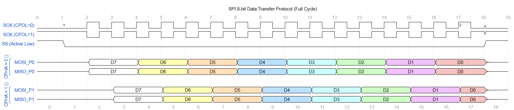

### Master FSM

`IDLE → START → DATA → STOP → IDLE` 4-state FSM입니다. `DATA` 상태에서 `half_tick`마다 `sclk`를 토글하면서 MSB(`tx_shift_reg[7]`)부터 `MOSI`로 송신하고, 같은 시점에 `MISO`를 `rx_shift_reg`로 shift-in 하며 `bit_cnt`가 7이 되면 `STOP`으로 넘어가 `done`을 올립니다.

  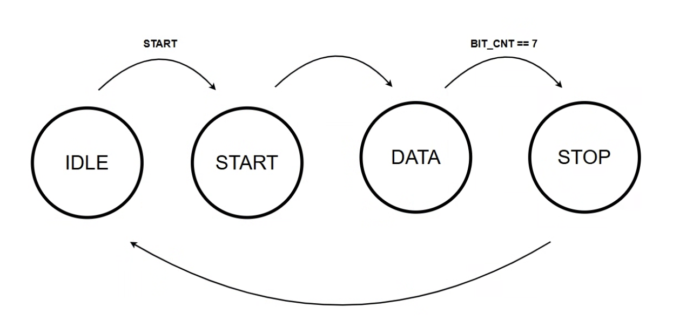

  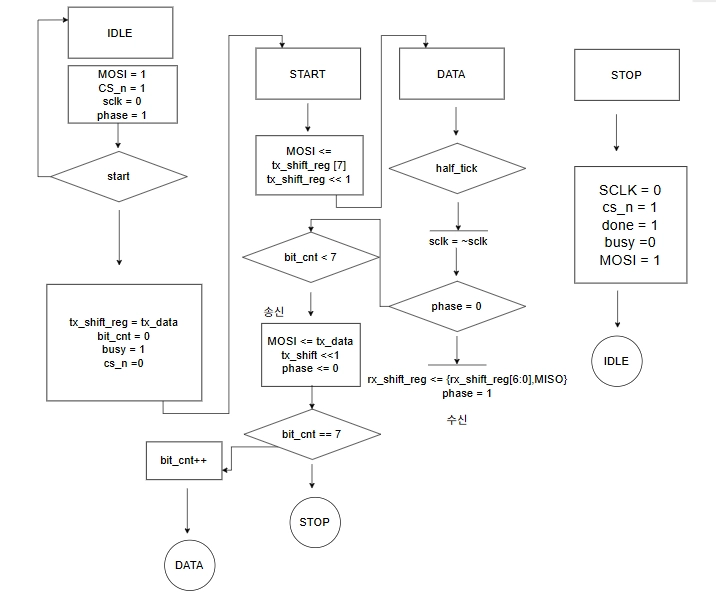

### Slave FSM

`IDLE → START → DATA_RX → DATA_TX → STOP` 구조입니다. `CS_N`이 Low가 되면 시작하고, SCLK의 **상승 엣지**에서 수신(`DATA_RX`), **하강 엣지**에서 송신(`DATA_TX`)을 수행하며 `bit_cnt == 7`이면 `STOP`으로 이동합니다.

  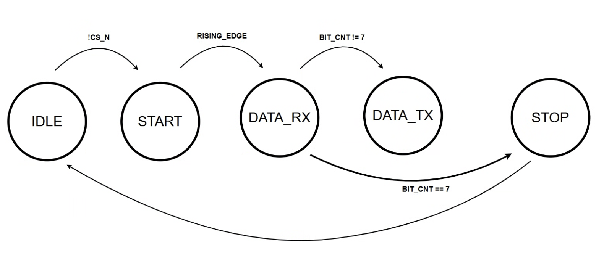

  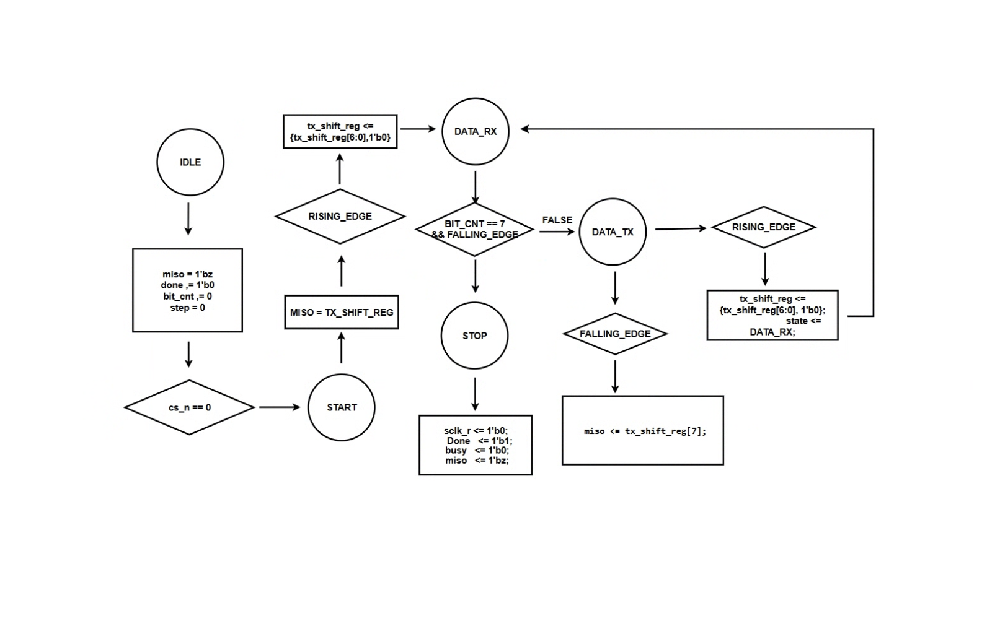

### Block Diagram

`spi_master` → `spi_slave` → `FND_CONTROLLER`(Control Unit + Datapath) → FPGA 7-Segment(`FND_DATA`, `FND_DIGIT`) 구조로, Slave가 수신한 데이터를 FND에 표시해 Write 동작을 눈으로 확인합니다.

  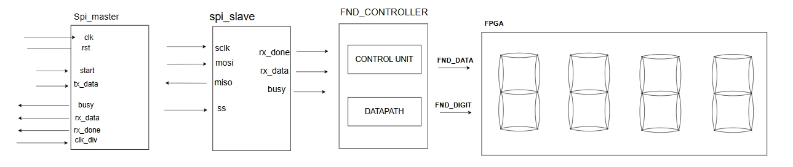

### Simulation Waveform

  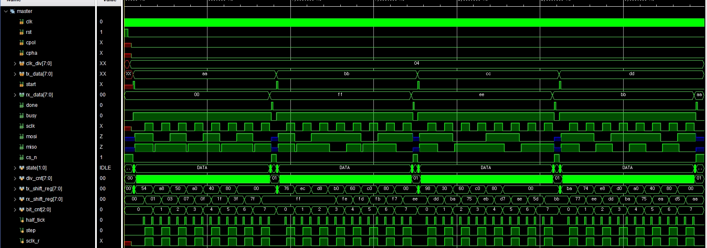

  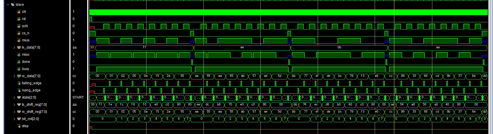

---

## 🔁 I2C

### Protocol

* 두 가닥의 선(`SDA`, `SCL`)만으로 마스터와 여러 슬레이브(1:N)를 연결하는 동기식 직렬 통신 프로토콜.
* **Open-drain** 구조: 신호 유지를 위해 외부 풀업 저항이 필요하고, 데이터선이 하나이므로 한 번에 한 방향만 통신하는 **반이중(Half-Duplex)** 방식.
* SPI에 비해 속도는 느리지만 하드웨어 구성이 간단해 칩 설계 비용이 낮음.
* 표준 속도는 100 kbps (SCL 100 kHz).

  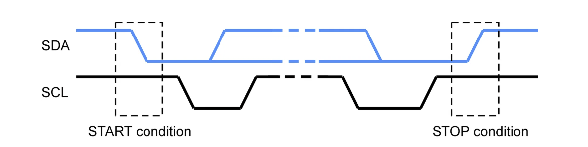

  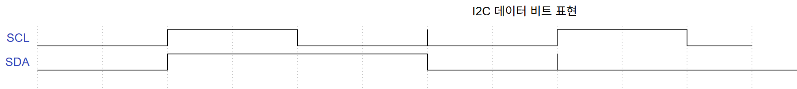

### Master FSM

`IDLE → START → WAIT_CMD → DATA → DATA_ACK → STOP` 구조입니다. `cmd_start`, `cmd_write`, `cmd_read`, `cmd_stop` 명령을 받아 동작하며, 비트당 `qtr_tick` 기준 4단계로 `SCL`을 생성합니다. `WAIT_CMD`에서 `CMD_START`가 다시 들어오면 `START`로 돌아가고(Repeated START), `CMD_STOP`이면 `STOP`으로 갑니다.

  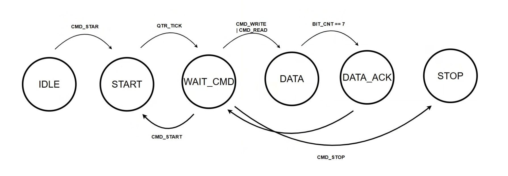

  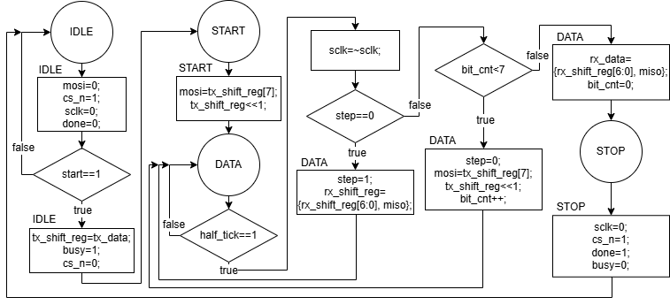

### Demo Top FSM

스위치(`SW`)가 켜지면 Master를 구동하는 데모용 Top FSM입니다. `IDLE → START → ADDR → WRITE → STOP`으로 진행하며 각 단계에서 `DONE` 신호를 확인하고 다음 단계로 넘어갑니다.

  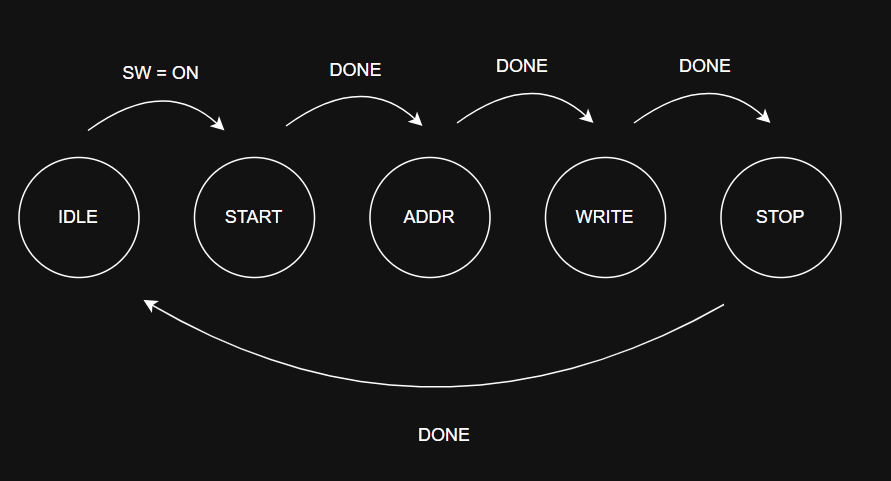

  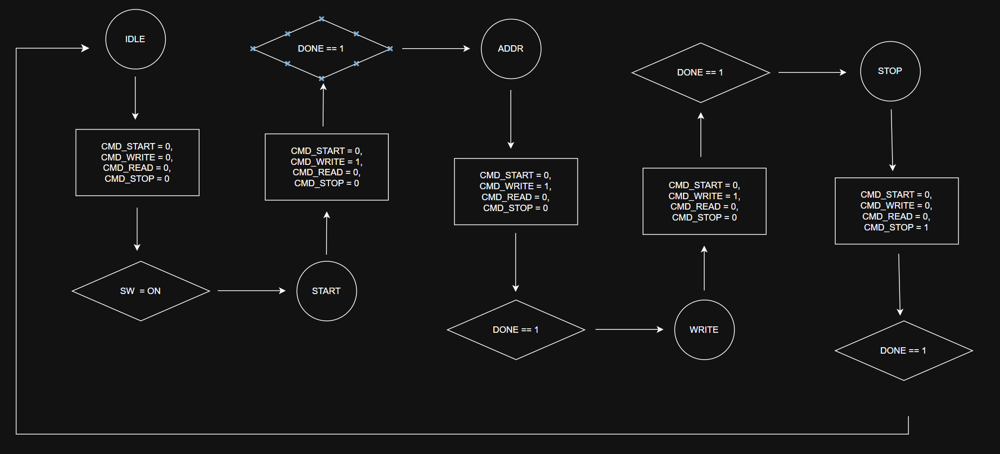

### Block Diagram

I2C Master는 `SDA` 라인에 tri-state 버퍼(`sda_o` / `sda_i`)를 사용하고, `SCL`·`SDA`는 3.3V 풀업 저항으로 연결됩니다. Slave가 수신한 데이터는 FND로 출력됩니다.

  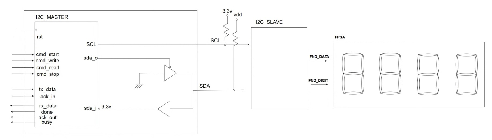

### Simulation Waveform

Master가 Slave 주소(`SLA[6:0] = 0x12`)에 쓰기(`0x24`)를 수행한 뒤 `0x55`, `0xAA`, `0x01`~`0x06`, `0xFF`를 순서대로 전송하고, 읽기(`0x25`)로 `0x01`~`0x05`를 되읽는 시나리오입니다.

  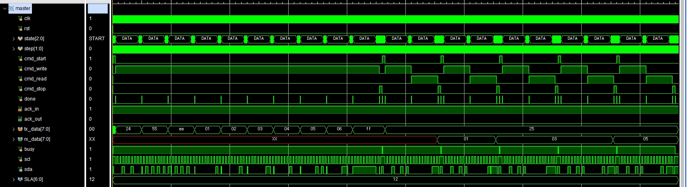

  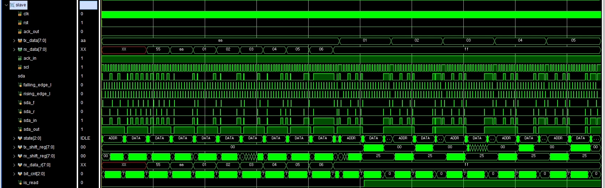

  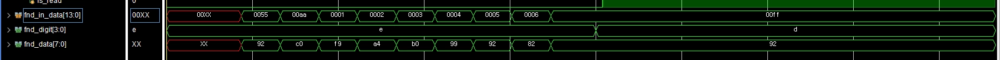

<b>Tcl Console Log 보기</b>

  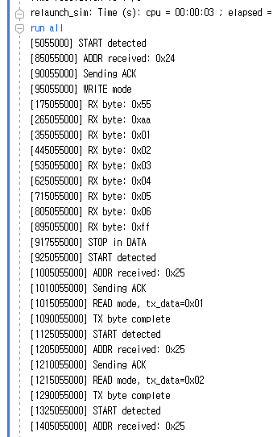
  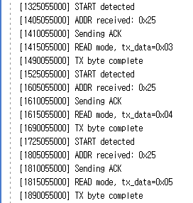

---

## 🧪 UVM Verification

* **Tools**: Synopsys VCS W-2024.09-SP1, Verdi, UVM-1.2
* **환경**: Top(Master + Slave + FND)을 DUT로 두고 스위치(`sw`)와 시작 버튼(`btn_start`)으로 자극을 인가한 뒤, **FND 출력으로 Write / Read 결과를 검증**합니다.
* **구성**: Driver · Monitor · Sequencer · Scoreboard · Functional Coverage

| 항목 | 카테고리 | SPI | I2C |
| :--- | :--- | :--- | :--- |
| **A: Directed Test** | 프로토콜 정합성 | Mode 0, 특정 데이터(`0x16`) 패턴 검증 | 특정 데이터(`0x55`, `0xAA`) 패턴 검증 |
| **B: Random Test** | 스트레스 및 커버리지 | 무작위 데이터 연속 WRITE / READ | 무작위 데이터 연속 WRITE / READ |

### 결과 요약

| 프로토콜 | 테스트 | Scoreboard | Overall Coverage | 세부 커버리지 |
| :---: | :--- | :---: | :---: | :--- |
| **SPI** | Directed | **PASS** (Match 1, Error 0) | 37.50% | `cp_btn` 100% / `cp_sw_nibble` 50% / `cp_sw_pattern` 0% / `cx_sw_pattern_nibble` 0% |
| **SPI** | Random | — | 59.38% | `cp_btn` 100% / `cp_sw_nibble` 100% / `cp_sw_pattern` 25% / `cx_sw_pattern_nibble` 12.5% |
| **I2C** | Directed | **PASS** (Transaction 4, Error 0) | 40.00% | SW Input 100% / FND Data 0% / Cross(SW × FND) 0% |
| **I2C** | Random | **PASS** (Transaction 6, Error 0) | 40.00% | `cp_btn` 100% / `cp_sw` 100% / `cp_fnd_data` 0% / `cp_fnd_digit` 0% / `cx_sw_fnd` 0% |

> Scoreboard는 모두 에러 없이 통과했지만 Functional Coverage는 100%에 도달하지 못했습니다. 개선 계획은 [Troubleshooting & Future Work](#-troubleshooting--future-work)에 정리했습니다.

### SPI

**Directed Test** — Mode 0, 데이터 `0x16`

  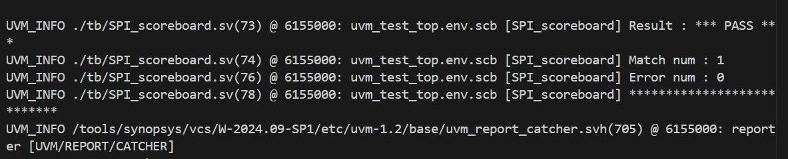

  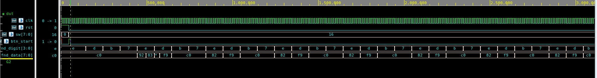

  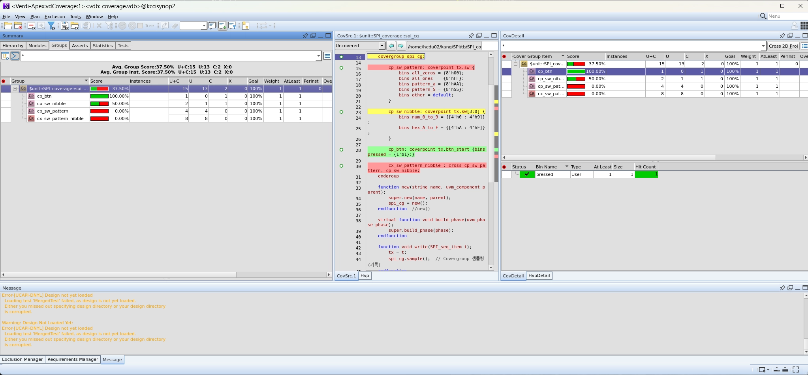

**Random Test**

  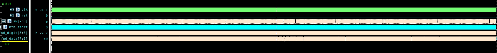

  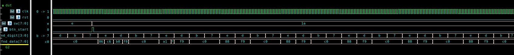

  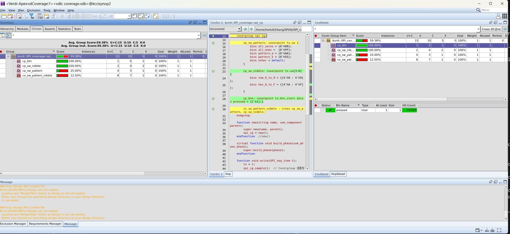

### I2C

**Directed Test** — 데이터 `0x55`, `0xAA`

  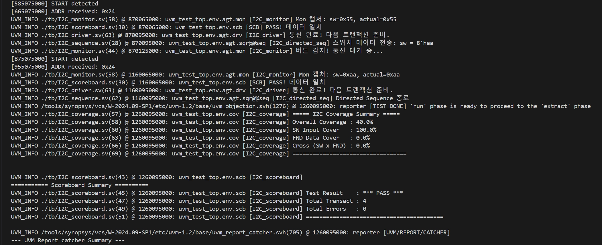

  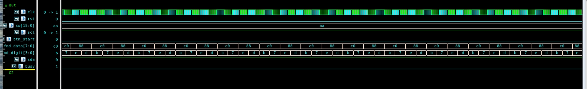

  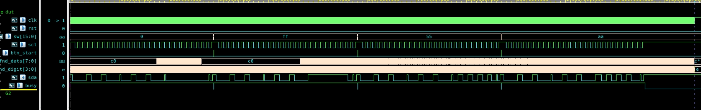

  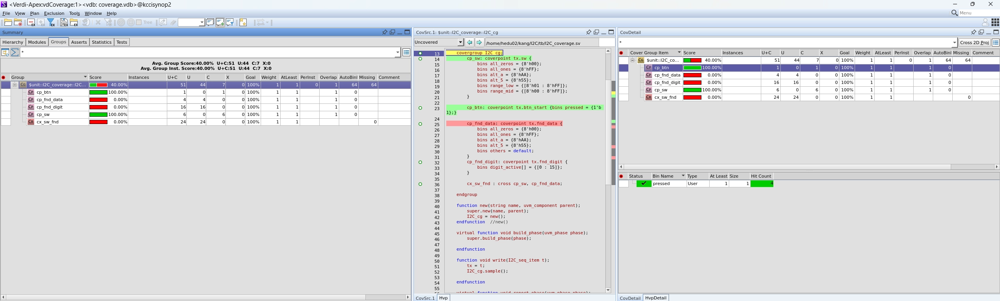

**Random Test**

  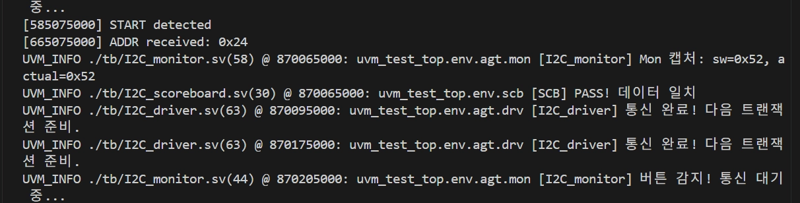

  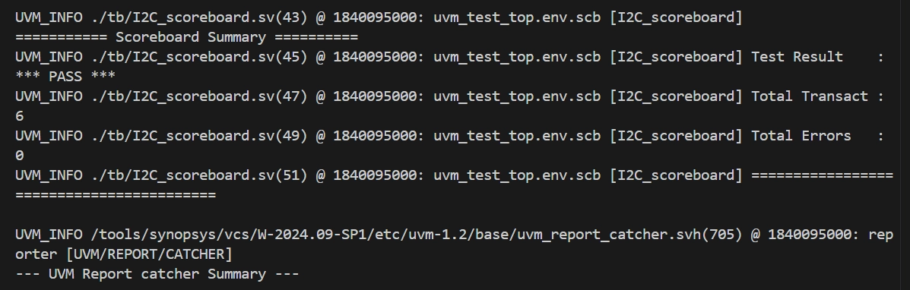

  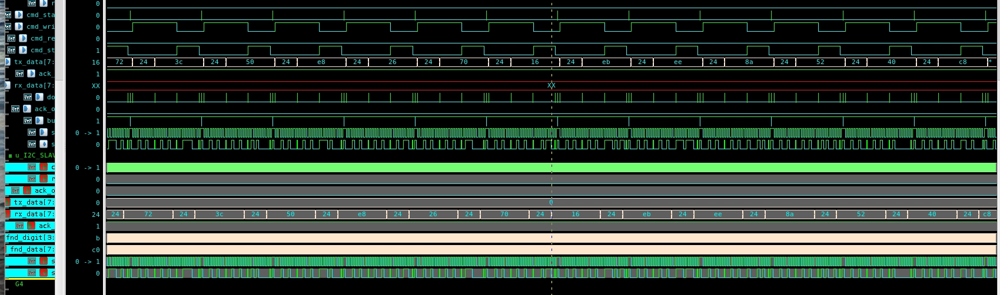

  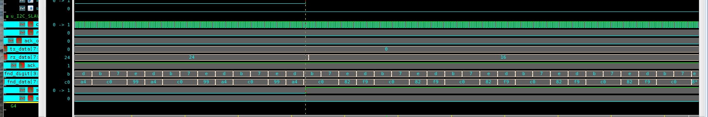

  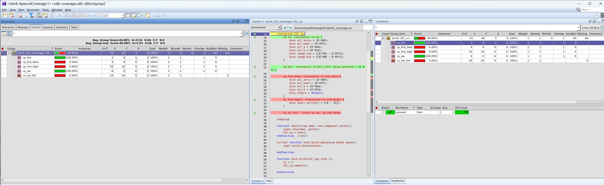

---

## 🎬 Implementation

FPGA 보드(Basys 3)를 활용했고, 두 가지 구조로 확인했습니다.

* **개별 동작**: 보드 1대에서 **Loopback** 구조로 Master와 Slave를 함께 구현해 검증
* **팀 동작**: 보드 2대로 Master와 Slave를 나누어 구현 (팀원: 조아라)

### 개별 동작 (Loopback)

  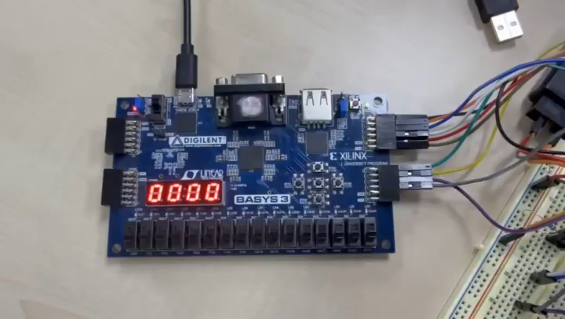
  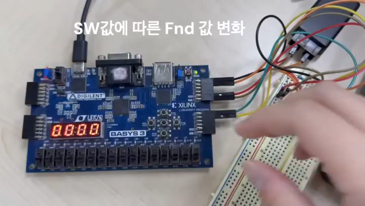

> ▶ **[SPI 개별 동작 영상](docs/demo_spi_loopback.mp4)** · **[I2C 개별 동작 영상 (SW값에 따른 FND 값 변화)](docs/demo_i2c_loopback.mp4)**

### 팀 동작 (Master ↔ Slave, 보드 2대)

스위치(`SW`) 값을 바꾸면 다른 보드의 FND에 해당 값이 표시되는 Master–Slave 간 통신 동작을 확인했습니다.

  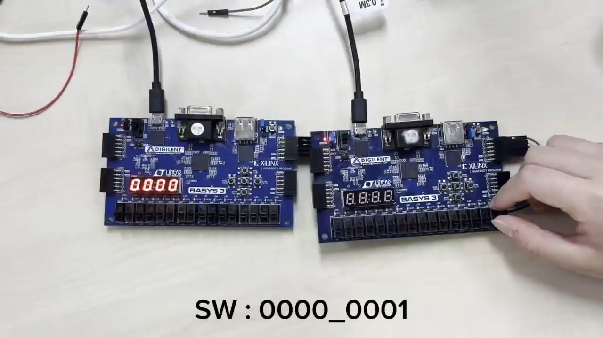
  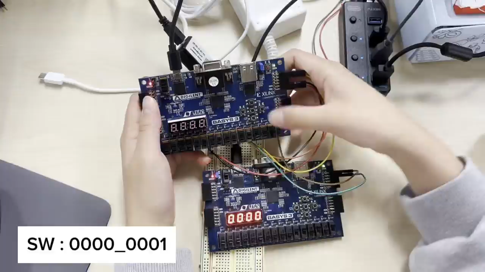

> ▶ **[팀 동작 영상 1](docs/demo_team_1.mp4)** · **[팀 동작 영상 2](docs/demo_team_2.mp4)**

---

## 🔧 Troubleshooting & Future Work

| # | 문제 현상 (Issue) | 원인 및 해결 |
| --- | --- | --- |
| **1** | **SPI Slave `edge_detector` 오류** — SCK 엣지가 간헐적으로 누락됨 | SCK를 클럭이 아닌 **데이터 입력**으로 취급해 2-stage synchronizer로 동기화하고, edge-detect FF를 synchronizer와 분리해 해결 |
| **2** | **UVM 검증 중 Timing 오류** | _(원인 및 해결 과정을 직접 작성해 주세요)_ |
| **3** | **Coverage 한계** — 최대 59.38%(SPI Random), 40.00%(I2C) | 시나리오 다양화로 개선 예정 (아래 향후 계획) |

### 향후 계획

* Functional Coverage **100%** 달성
* Read Test를 **실제 보드에서 구현**

---

## 👨‍💻 Author

- **GitHub**: [@ethan000106](https://github.com/ethan000106)
